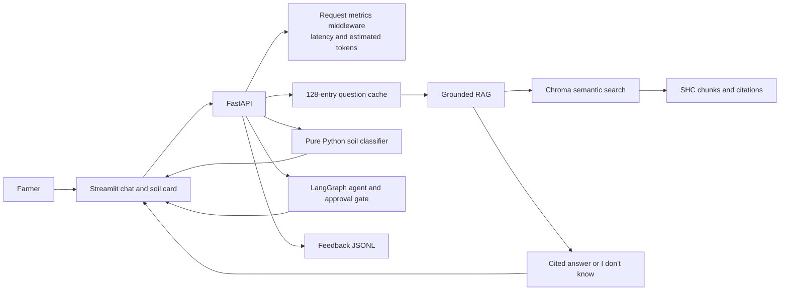
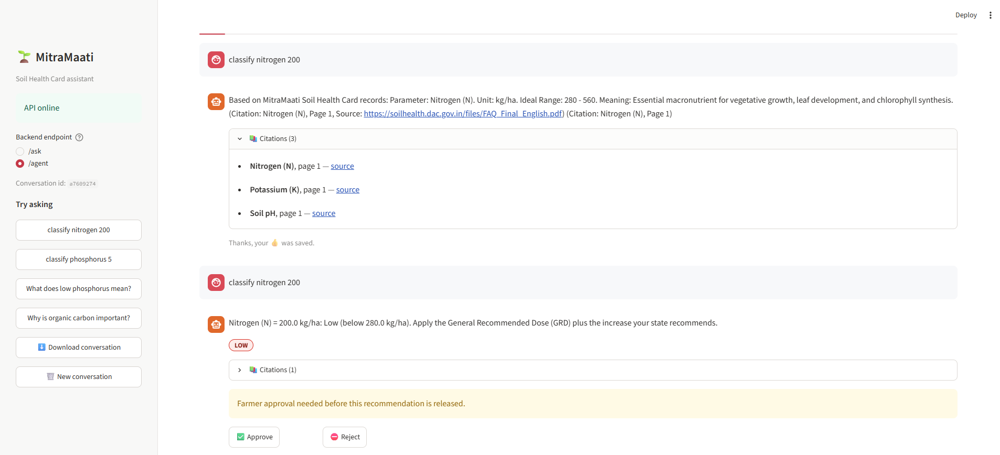
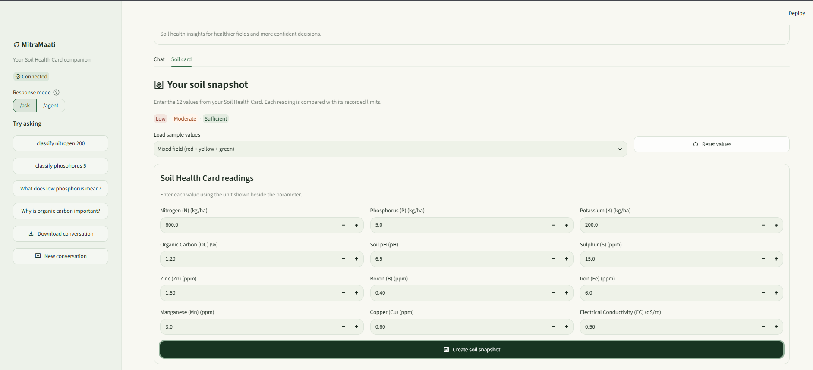
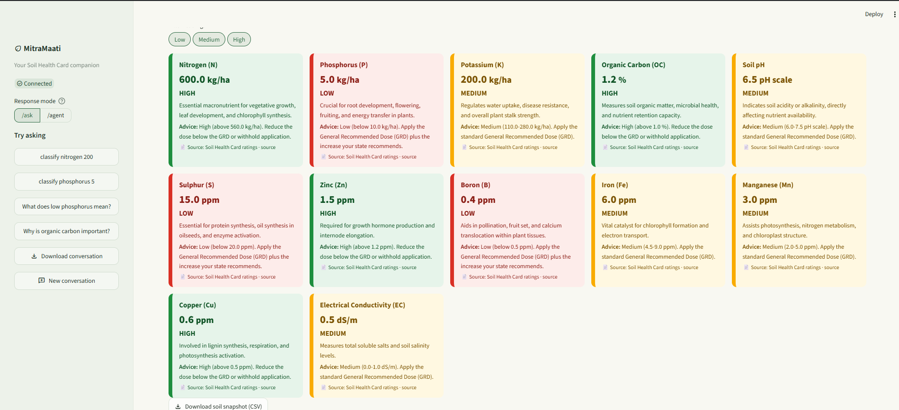

[](https://github.com/Priyu49/Examate-15days_Project-/actions/workflows/ci.yml)

# 🌱 MitraMaati - Soil Health & Nutrient Advisory System

MitraMaati is an intelligent agricultural advisory platform designed to analyze Soil Health Cards (SHC), track macronutrients and micronutrients (NPK, pH, Organic Carbon, etc.), and provide grounded fertilizer and crop recommendations for Indian farmers with strict source citations.

---

## 🏗️ Architecture Breakdown

MitraMaati is built using a modern, production-grade technical stack:
- **Backend Framework:** FastAPI running on Python 3.13, delivering asynchronous REST endpoints (`/health`, `/records`, `/ask`, `/search/semantic`, `/agent`).
- **Vector Database & Embeddings:** ChromaDB (`PersistentClient`) coupled with Hugging Face's `sentence-transformers` (`all-MiniLM-L6-v2`) for semantic chunk embedding and similarity retrieval.
- **Agentic Workflow:** LangGraph framework implementing state management, conversational memory, and human-in-the-loop approval gates for custom agronomic actions (`POST /agent`).
- **Evaluation & Guardrails:** Automated evaluation runner (`eval/run_eval.py`) verifying answer accuracy, citation recall, and strict safety boundary enforcement for out-of-scope queries.

---

## 📅 15-Day Project Roadmap & Daily Progress

| Day | Module / Topic | Key Implementation Files | Status |
| :--- | :--- | :--- | :--- |
| **Day 01** | Project Intro & CLI Menu | `Day01_Intro.py`, `Day01_menu.py` | Completed |
| **Day 02** | Data Structures & Sample Records | `sample_records.py`, `records.py` | Completed |
| **Day 03** | FastAPI Backend & Core Endpoints | `app/ingest.py`, `main.py`, `test_main.py` | Completed |
| **Day 04** | Pandas Analytics & Data Exploration | `explore.py`, `data/records.json` | Completed |
| **Day 05** | TF-IDF Smart Search Engine | `smart_search.py` | Completed |
| **Day 06** | LLM Integration & Prompt Engineering | `app/llm.py`, `prompts/` | Completed |
| **Day 07** | Document Chunking & Chroma / Vector Store | `app/chunking.py`, `app/embed.py`, `app/vectorstore.py` | Completed |
| **Day 08** | RAG Pipeline, Citations & Evaluation Set | `app/rag.py`, `POST /ask`, `eval/eval_set.json`, `eval/run_eval.py` | Completed |
| **Day 09** | Soil Classification Tools & LangGraph Agent | `app/tools.py`, `app/agent_loop.py`, `app/graph.py`, `POST /agent` | Completed |
| **Day 10** | Streamlit UI, Citations Feedback & Traffic-Light Soil Card | `ui/app.py`, `POST /feedback`, `POST /soil-card`, `check_day10.py` | Completed |
| **Day 11** | Pytest Suite (23 Tests), Ruff Linting & Docker Setup | `tests/test_basics.py`, `tests/test_graph.py`, `tests/test_main.py`, `ruff.toml`, `Dockerfile`, `docker-compose.yml` | Completed |
| **Day 12** | GitHub Actions CI & Render deployment config | `.github/workflows/ci.yml`, `render.yaml` | Completed |


## 📊 RAG Evaluation Benchmark Winner Table

An automated evaluation runner (`eval/run_eval.py`) was executed against the project's evaluation set (`eval/eval_set.json`) comparing multiple retrieval configurations:

| Configuration | Chunk Size | Top-K | Accuracy | Citation Recall | Safety Score | Score | Status |
|---------------|------------|-------|----------|-----------------|--------------|-------|--------|
| Config A (Narrow / Top-1) | 120 chars | 1 | 80.0% | 80.0% | 80.0% | 4/5 | Baseline |
| **Config B (Standard / Top-3)** | **250 chars** | **3** | **80.0%** | **100.0%** | **100.0%** | **4/5** | **[WINNER]** |
| Config C (Broad / Top-5) | 400 chars | 5 | 80.0% | 100.0% | 100.0% | 4/5 | Baseline |

**Conclusion:** **Config B (`top_k=3`, chunk size 250)** is selected as the winning configuration, achieving 100% citation recall and perfect safety score handling for boundary queries.

---

## ⚙️ API Endpoints Reference

- `GET /` — Welcome check
- `GET /health` — System health status check
- `GET /records` — Retrieve all tracked soil health records
- `GET /records/{sample_id}` — Retrieve specific soil record details
- `GET /search?q=` — Smart TF-IDF record search
- `GET /search/semantic?q=` — Semantic vector store similarity search
- `POST /ask` — Grounded RAG advisory endpoint with citations and fallback handling
- `POST /agent` — LangGraph agent endpoint with memory and approval state

## 🚀 Production Notes

### The problem MitraMaati solves

Soil Health Cards contain useful nutrient measurements and recommendations, but farmers can struggle to interpret thresholds, connect a reading to a practical next step, and verify where advice came from. MitraMaati turns those readings into plain-language, cited answers and a color-coded view of all 12 parameters. It keeps recommendations within the available SHC material and says when the records cannot answer a question.

### Request architecture



### Demo

**Demo video:** _Recording link not provided yet._ Add a public video URL here when the walkthrough is uploaded. The [README screenshots](#day-10---streamlit-ui) show the chat, soil-card inputs, and classified results in the meantime.

### Evaluation results

The checked-in RAG benchmark reports these results for its 5-question evaluation set:

| Selected configuration | Fact accuracy | Citation recall | Boundary safety | Evaluation set |
|---|---:|---:|---:|---:|
| 250-character chunks, top 3 | 80% | 100% | 100% | 5 questions |

These are project evaluation results, not a production traffic or agronomic-outcomes study. See the [retrieval configuration comparison](#-rag-evaluation-benchmark-winner-table) and run `python eval/run_eval.py` to reproduce the benchmark.

### Operational behavior and limits

- Each HTTP request logs its method, path, status, latency in milliseconds, and approximate input/output/total tokens. Token counts are estimated from payload bytes (about 4 bytes per token); request and response contents are not logged.
- `/ask` caches up to 128 normalized question and `top_k` combinations in process memory. Restarting the API clears the cache; this is a small single-instance optimization, not a shared distributed cache.
- Text inputs are limited to 1,000 characters, feedback answers to 4,000 characters, and soil-card payloads to 12 values. `/ask` accepts `top_k` from 1 to 5.
- Retrieved text is treated as untrusted reference material in the system prompt. A regression test checks that an instruction to reveal the system prompt does not appear in the answer.

---

## 🛠️ Installation & Local Setup

1. **Clone the Repository:**
   ```powershell
   git clone [https://github.com/Priyu49/Examate-15days_Project-.git](https://github.com/Priyu49/Examate-15days_Project-.git)
   cd Examate-15days_Project-
   ```

2. **Install dependencies:**
   ```powershell
   pip install -r requirements.txt
   ```

3. **Start the API (terminal 1):**
   ```powershell
   uvicorn main:app --reload
   ```

4. **Start the Streamlit UI (terminal 2):**
   ```powershell
   streamlit run ui/app.py
   ```
   The UI talks to `http://127.0.0.1:8000` (override with the `MITRAMAATI_API` environment variable).

---

## 🧠 Day 9 - Agent notes

- `graph.py` is compiled with `MemorySaver`; each conversation is a `thread_id`, so follow-up questions remember earlier turns.
- `approval_node` calls `interrupt()` and only continues when resumed with `Command(resume=True/False)`.
- Questions containing a parameter and a number (e.g. "classify nitrogen 200") are routed to `classify_soil_card`; everything else goes to RAG.
- Tests: `pytest` (see `test_graph.py`).

## 🖥️ Day 10 - Streamlit UI

- **Chat** calls `/ask` (grounded RAG) or `/agent` (LangGraph agent). Every answer shows its **citations** (title, page when known, source link). Example questions in the sidebar, live API status, and chat download.
- **Thumbs up / down** under each answer is saved to `data/feedback.jsonl` through `POST /feedback`.
- **Farmer approval:** in `/agent` mode a Low/High reading pauses the graph (`interrupt()`); the farmer presses Approve or Reject and the graph resumes on the same `thread_id`.
- **Traffic-light soil card:** type the 12 Soil Health Card values (or load a sample field); each appears as a red (Low), yellow (Medium) or green (High) tile with a one-line meaning, the dose advice and its source (`POST /soil-card`, which runs `classify_soil_card`). Includes summary counts, a status filter and CSV download.





**Self-check:** `python check_day10.py` verifies files, tests, API endpoints and that the UI loads.


### Signature Feature: Traffic-Light Soil Card
Enter your 12 Soil Health Card (SHC) parameter values to get an instant color-coded assessment:
- **Green (Sufficient):** General Recommended Dose (GRD) minus 30%
- **Yellow (Moderate):** Standard General Recommended Dose (GRD)
- **Red (Low):** GRD plus the state-specified increase

Each tile displays a plain-language meaning alongside the exact cited document page.

---

## Testing & Code Quality (Day 11)

MitraMaati includes a `pytest` suite (23 tests covering records, search, `/health`, `/ask` with a mocked LLM, and `classify_soil_card`) and `ruff` linting.

```powershell
# Run all pytest tests
pytest

# Run ruff linter
ruff check .
```

## Deploy on Render

This repository includes a Render Blueprint (`render.yaml`) for the FastAPI service. Render builds the Dockerfile and checks `GET /health`.

- **Live API:** [https://mitramaati-api.onrender.com](https://mitramaati-api.onrender.com)
- **Health check:** [https://mitramaati-api.onrender.com/health](https://mitramaati-api.onrender.com/health) (`{"status":"healthy"}`)
- **Interactive API docs:** [https://mitramaati-api.onrender.com/docs](https://mitramaati-api.onrender.com/docs)

Add any required model-provider API keys as Render environment variables before using endpoints that need an LLM provider.

## Run with Docker

```bash
docker compose up --build
```

- UI: http://localhost:8501
- API docs: http://localhost:8000/docs

Put any API keys in a `.env` file (never commit it). Stop with `docker compose down`.

## 🏷️ Checkpoints

Checkpoint 2 demo: tag `checkpoint-2`.
